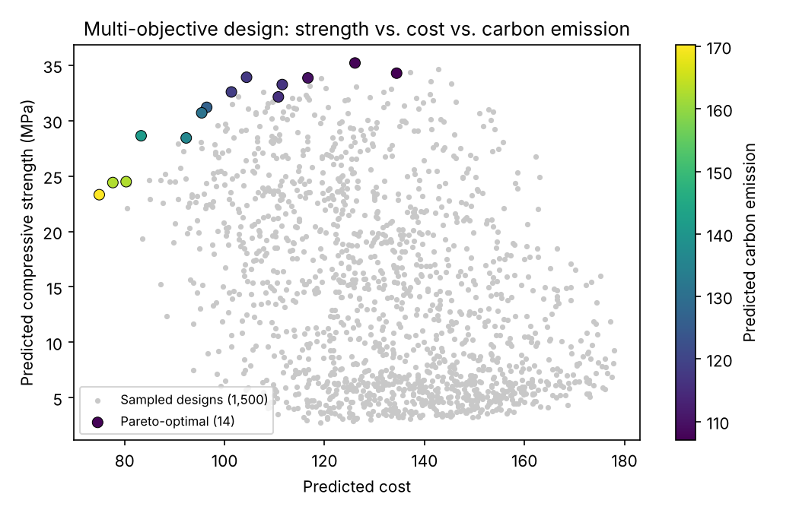

# AI-Driven Design Platform for Resin-Coated Materials

An end-to-end machine learning platform for materials design: it unifies heterogeneous materials data, predicts properties, inversely designs recipes for target properties, generates validation protocols, and recommends the next experiments in a closed loop. All five modules are connected through a single desktop GUI.

> **Note:** This repository runs on **simulated data** generated to mimic real experimental, literature, and process-log sources (including unit mismatches, missing values, and outliers). No proprietary data is included.



*Multi-objective design search: 1,500 sampled recipes (grey) and the Pareto-optimal set trading off compressive strength, cost, and carbon emission (colored).*

---

## Workflow

```
 Raw data (experiments · literature · process logs)
        │
        ▼
 ① Data Integration ──► ② Reverse Design ──► ③ Validation Protocol
   ETL, unit harmonization,   Forward DNN + L-BFGS-B      ASTM/ISO standards mapping,
   outlier handling,          inversion, Pareto           synthesis & test protocols
   GAN augmentation           optimization                     │
        ▲                                                      │ experimental feedback
        └──────────────── ④ Autonomous Experiment ◄────────────┘
                           Bayesian optimization + active learning,
                           automatic retraining, next-experiment ranking

 ⑤ Desktop GUI: one control panel for all modules, with a results dashboard
```

## Modules

| Module | What it does | Key methods |
|---|---|---|
| [`core2_data_integration`](core2_data_integration) | Ingests three heterogeneous sources into one schema | ETL, unit harmonization, IQR/z-score outlier handling, SQLAlchemy schema, NumPy GAN for data augmentation, KS/Wasserstein similarity metrics |
| [`core1_reverse_design`](core1_reverse_design) | Predicts properties from recipes and inverts the model to find recipes for a target | Regularized MLP with cross-validated L2 penalty, L-BFGS-B inverse optimization over continuous and categorical variables, Pareto filtering |
| [`core3_validation_protocol`](core3_validation_protocol) | Turns a recommended recipe into a synthesis and testing plan | Property-to-standard knowledge base (ASTM/ISO), fuzzy matching with confidence scores, rule-based protocol generation, feedback loop into the database |
| [`core4_autonomous_experiment`](core4_autonomous_experiment) | Recommends the most informative next experiments | Gaussian-process Bayesian optimization (Expected Improvement), uncertainty sampling, automatic retraining with convergence tracking |
| [`resin_project_gui`](resin_project_gui) | Desktop control panel and dashboard | Tkinter, background threading, Matplotlib dashboard |

Each module is a standalone package with its own `example_usage.py` demo and a FastAPI service (`api.py`).

## Quick Start

```bash
git clone https://github.com/murad-sciml/resin-materials-ai.git
cd resin-materials-ai
pip install -r requirements.txt

# Launch the GUI (recommended)
cd resin_project_gui
python app.py
```

In the GUI, work through the tabs in order: **Data Integration → Reverse Design → Validation Protocol → Autonomous Experiment → Dashboard**. A console panel logs every step.

### Run individual modules

```bash
cd core2_data_integration && python example_usage.py   # data pipeline + GAN augmentation
cd core1_reverse_design   && python example_usage.py   # train model, reverse design, Pareto front
cd core3_validation_protocol && python example_usage.py # protocol for a recommended recipe
cd core4_autonomous_experiment && python example_usage.py # closed-loop optimization demo
```

### Run as REST APIs

```bash
cd core1_reverse_design && python api.py                        # port 8001
cd core2_data_integration && uvicorn api:app --port 8002
cd core3_validation_protocol && python api.py                   # port 8003
cd core4_autonomous_experiment && uvicorn api:app --port 8004
```

## Results

On the bundled simulated dataset (180 unique samples from three sources):

**Property prediction** (forward model, 5-fold cross-validation)

| Property | R² (mean ± std) |
|---|---|
| Compressive strength | 0.834 ± 0.050 |
| Flexural strength | 0.886 ± 0.048 |
| Viscosity | 0.823 ± 0.047 |
| Carbon emission | 0.851 ± 0.025 |
| Cost | 0.950 ± 0.014 |
| **Mean across properties** | **0.869** |

**Reverse design:** for a target compressive strength of 30 MPa, the inverse search returned a recipe predicted at 30.0 MPa in about 1.4 s, searching all curing-method and additive combinations on a standard CPU.

**Multi-objective search:** 14 Pareto-optimal recipes were identified from 1,500 sampled designs (figure above).

**Data pipeline:** unit harmonization across sources, idempotent ingestion (re-running adds no duplicates), and outlier handling that also rejects physically impossible negative readings. Experimental feedback is checked for plausibility before it enters the training data.

## Design Highlights

- **Small-data modeling:** the forward model selects its L2 regularization by cross-validation, which matters with only a few hundred training samples.
- **Mixed-variable inverse design:** discrete choices (curing method, additive combinations) are enumerated, and L-BFGS-B optimizes the continuous recipe variables for each combination.
- **Closed loop:** experimental feedback from the validation module is written back into the integrated database and used to retrain the Bayesian optimizer.
- **Responsive GUI:** all long-running training and optimization runs in background threads, with Tkinter state read on the main thread for thread safety.

## Tech Stack

`Python` · `NumPy` · `pandas` · `SciPy` · `scikit-learn` · `SQLAlchemy` · `FastAPI` · `Tkinter` · `Matplotlib`

## Author

**Murad Ali Khan**, PhD Researcher, AI for Materials Discovery, Jeju National University
[Google Scholar](https://scholar.google.com/citations?user=--dAXhkAAAAJ) · [LinkedIn](https://www.linkedin.com/in/murad1996/)

## License

Released under the [MIT License](LICENSE).
